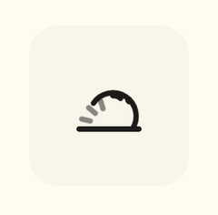
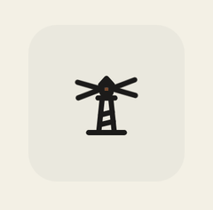
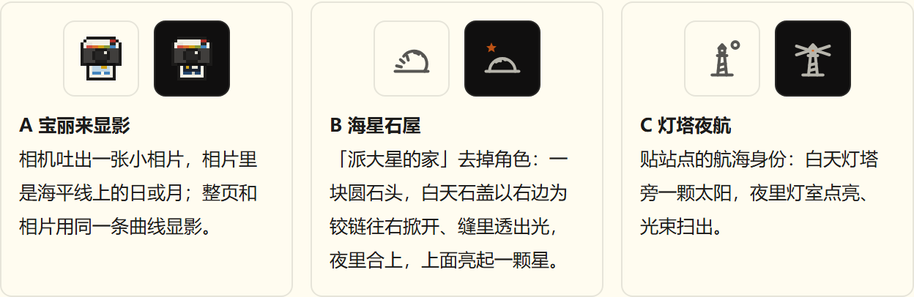

# Polaroid Theme Toggle · 宝丽来显影昼夜切换

点一下右上角的相机，相机吐出一张新相片，整页像相片一样慢慢显影成夜色。切换的全过程里，正文一刻都不会糊成一片。

**在线试**：[打开小样](https://schemingboy.github.io/polaroid-theme-toggle/)，右下角「实验台」能换图标方向、和别的切换方式并排比、慢放 5 倍看清每一帧。

## 三个图标

| A · 宝丽来显影 | B · 海星石屋 | C · 灯塔夜航 |
|---|---|---|
|  |  |  |
| 像素版 OneStep 相机。点一下，旧相片落下，新相片从出片口吐出来，画面从墨灰显影成白天的海或夜里的海。 | 派大星家那块圆石头。白天石盖以右边为铰链掀开，缝里透出光；夜里合上，头顶亮起一颗星。 | 线框灯塔。白天旁边挂着太阳；夜里灯室点亮，左右扫出光束。 |

直接打开某个方向：`index.html#A`、`#B`、`#C`。

## 为什么切换时字不会看不清

白天是深字浅底，夜里是浅字深底，切换时字和底的亮度要互换。常见的淡入淡出、颜色插值，中途一定会经过「字和底一样亮」的那一瞬，字就糊了。只是这一瞬长短不同。

这里的做法像冲洗相片：先让底色顺着一条慢坡变暗（或变亮），坡上有一个点，深字和浅字对底色的对比度刚好相等（这套配色下约 3.3:1）。就在那一帧把字色整个翻过去，所以字从来不会经过「和底一样亮」的时刻。灰、蓝、橙这些次要颜色先褪成正文色，等明暗定下来再慢慢回到自己的颜色。先出明暗，后出颜色，宝丽来显影也是这个顺序。

在 Chromium 里逐帧量过（1536×750，DPR 1.25，每 8ms 读一次颜色）：

| 方式 | 正文最低对比度 | 正文低于 3:1 的时长 | 每 16ms 最大亮度跳变 ΔL\* |
|---|---|---|---|
| 瞬间切换 | 11.98 | 0ms | 94.5（一帧全变） |
| 220ms 淡入 | 1.0 | 69ms / 65ms | 10.4 / 14.1 |
| 圆形扩散（从按钮处扩开） | 每处瞬切 | 0ms | 局部 94.5，而且有一道边扫过正在读的字 |
| **显影** | **3.34 / 3.28** | **0ms** | **5.5 / 4.3** |

斜线前是变暗，后是变亮。

时长：变暗 480ms，变亮 640ms（从暗处突然变亮才晃眼，所以变亮慢一点）。字在约 270ms 时就已经翻好，后面只是底色在沉淀。系统开了「减弱动态效果」时，图标的相片吐出、石盖掀开、光束扫动都改成直接换帧，不再有位移。

## 用到自己的站上

整个小样是一个不依赖任何库的 HTML 文件，打开 `index.html` 看源码即可：

- 配色都是 CSS 变量，`TOK` 里改成你的颜色，翻色时刻 `flipTime()` 会按新颜色自己算，不用手调
- 底色慢坡用 `CSS.registerProperty` 注册的变量加 `Element.animate`，不支持的老浏览器直接瞬切
- 按钮只有昼、夜两态，每次点都有变化；手动选过以后，页脚出现「跟随系统」，点它回到跟随系统

## 灵感

最早是看到 [Ely Office](https://office.elygpui.com/) 的昼夜切换觉得好看，想给自己的博客也做一个。小样「实验台」里的「圆形扩散」是按它的效果自己重做的，用来对比，没有用它的源码。

## 协议

[MIT](LICENSE)
